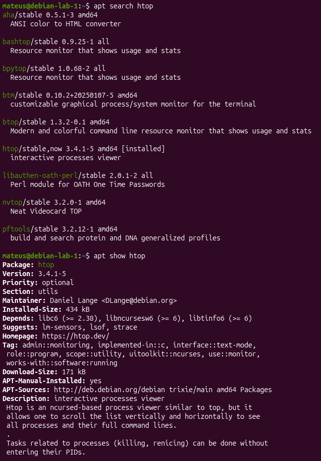
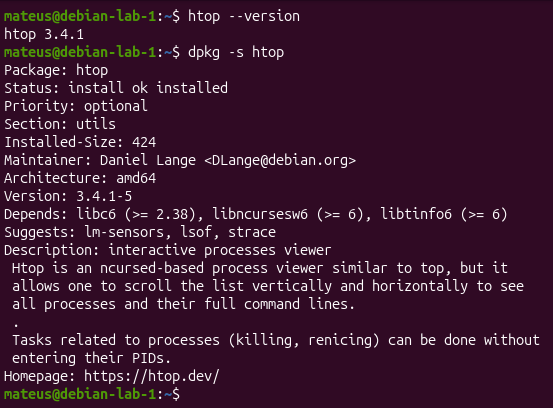
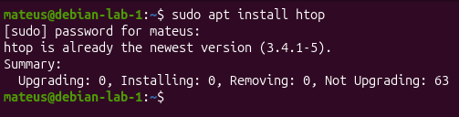
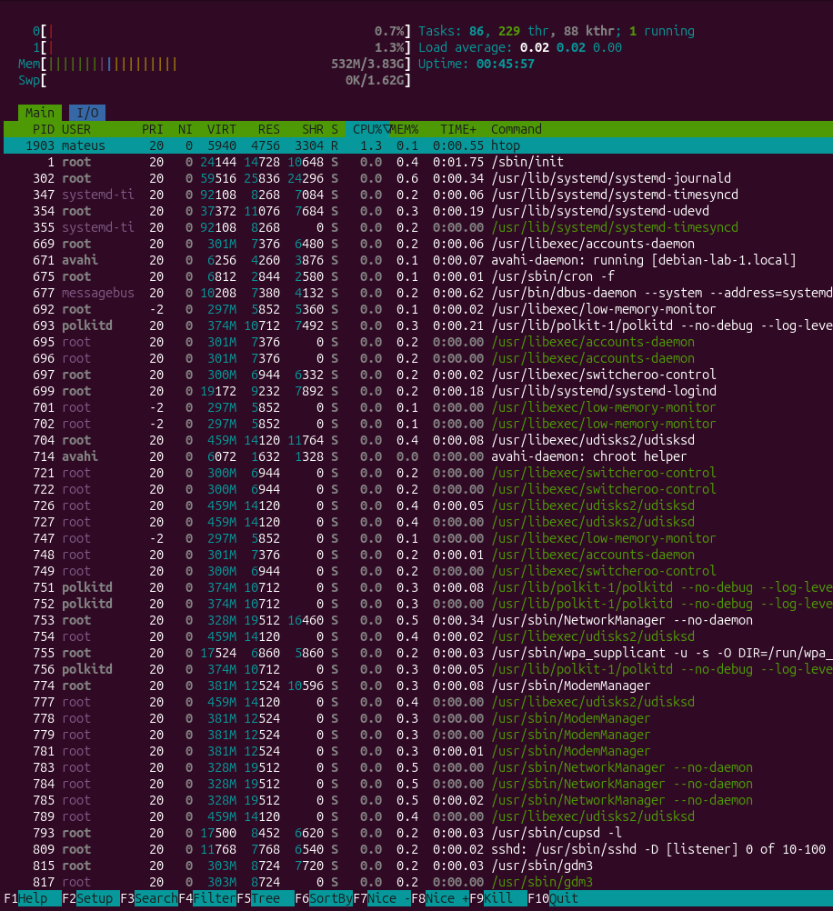

# Parte 10 — Gerenciamento de Pacotes

## 1. Objetivo

Pesquisar, instalar, consultar e executar uma ferramenta no Debian GNU/Linux, utilizando o gerenciador de pacotes APT.

A ferramenta escolhida foi o **htop**, um monitor interativo de processos e recursos do sistema.

## 2. Ambiente utilizado

- **Distribuição:** Debian GNU/Linux
- **Família:** Debian
- **Gerenciador de pacotes:** APT
- **Ferramenta:** htop
- **Versão do pacote:** 3.4.1-5

## 3. Evidências

### 3.1 — Pesquisa do pacote

Comandos executados:

```bash
apt search htop
apt show htop
```

O comando `apt search` permitiu localizar o pacote nos repositórios configurados. O comando `apt show` apresentou sua versão, descrição e dependências.



### 3.2 — Verificação da instalação

Comandos executados:

```bash
htop --version
dpkg -s htop
```

O comando `htop --version` apresentou a versão **3.4.1**.

O comando `dpkg -s htop` retornou o status `install ok installed`, confirmando que o pacote está registrado como instalado.



### 3.3 — Gerenciamento pelo APT

Comando executado:

```bash
sudo apt install htop
```

O APT informou que o `htop` já estava instalado na versão mais recente disponível, **3.4.1-5**, sem necessidade de instalar novos arquivos.



### 3.4 — Execução da ferramenta

Comando executado:

```bash
htop
```

A ferramenta foi executada com sucesso, permitindo visualizar processos ativos, consumo de CPU, memória RAM, PID e usuário responsável pelos processos.



## 4. Comparação entre famílias de distribuições

| Família | Distribuições | Gerenciador | Exemplo de instalação |
|---|---|---|---|
| Debian | Debian e Ubuntu | APT | `sudo apt install htop` |
| Red Hat | Fedora e RHEL | DNF | `sudo dnf install htop` |

O APT é utilizado em distribuições da família Debian, enquanto o DNF é utilizado em distribuições como Fedora e RHEL.

Ambos permitem instalar, atualizar e remover pacotes, além de gerenciar dependências.

## 5. Conclusão

Nesta atividade, foram utilizados os comandos `apt search`, `apt show`, `apt install`, `dpkg -s` e `htop --version`.

Foi confirmado que o pacote `htop` estava instalado e que sua execução funcionava corretamente no Debian.

A atividade também permitiu compreender as diferenças entre os gerenciadores de pacotes APT e DNF.

