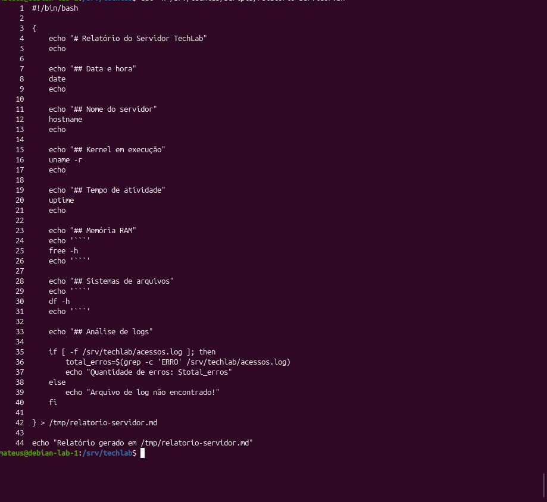
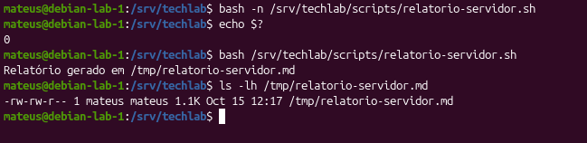
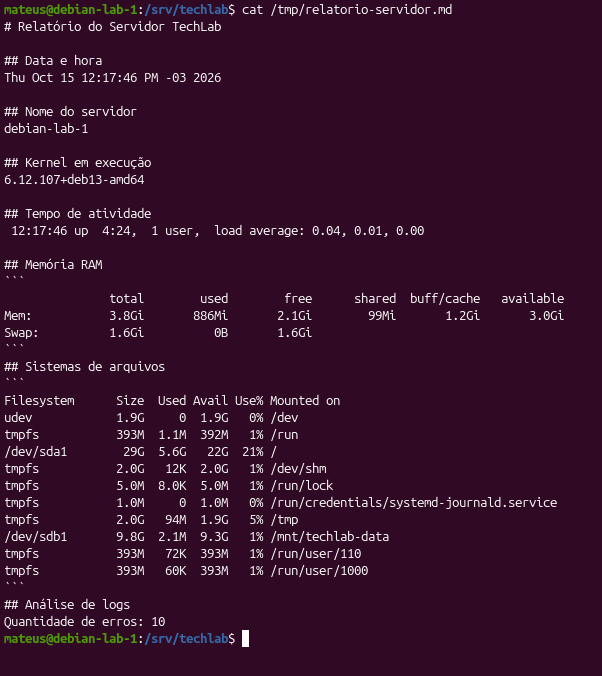
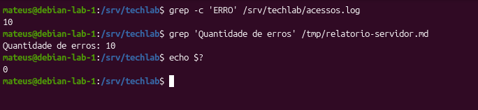
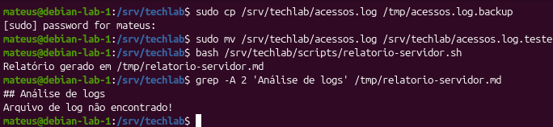
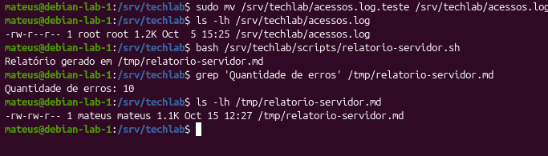

# Parte 11 — Automação de Relatórios com Shell Script

## 1. Objetivo

Desenvolver e executar um script Bash capaz de coletar informações do servidor TechLab e gerar automaticamente um relatório em formato Markdown.

A atividade tem como objetivo praticar conceitos de administração GNU/Linux, incluindo:

- Utilização de comandos administrativos;
- Criação e execução de scripts Shell;
- Variáveis e substituição de comandos;
- Estruturas condicionais `if/else`;
- Redirecionamento de saída;
- Leitura e análise de arquivos de log;
- Validação dos resultados obtidos.

## 2. Ambiente utilizado

| Item | Descrição |
|---|---|
| Sistema operacional | Debian GNU/Linux 13 |
| Servidor | `debian-lab-1` |
| Interpretador | Bash |
| Editor de texto | Vim |
| Script desenvolvido | `/srv/techlab/scripts/relatorio-servidor.sh` |
| Relatório gerado | `/tmp/relatorio-servidor.md` |
| Arquivo de log | `/srv/techlab/acessos.log` |

## 3. Desenvolvimento do script

Foi desenvolvido o script `relatorio-servidor.sh` para automatizar a coleta de informações do servidor.

O relatório reúne:

- Data e hora da execução;
- Nome do servidor;
- Versão do kernel;
- Tempo de atividade;
- Utilização da memória RAM;
- Espaço utilizado e disponível nos sistemas de arquivos;
- Quantidade de registros de erro presentes no arquivo de log.

O script utiliza comandos como `hostname`, `uname`, `uptime`, `free`, `df` e `grep`.

Também utiliza uma estrutura condicional `if/else` para verificar a existência do arquivo `acessos.log` antes de realizar a contagem de erros.

As informações coletadas são organizadas em seções Markdown e gravadas automaticamente no arquivo `/tmp/relatorio-servidor.md`.

### Evidência 01 — Código-fonte do script

O código-fonte atualizado demonstra os comandos utilizados, a estrutura condicional e o redirecionamento responsável pela criação do relatório.



## 4. Validação e execução

Antes da execução, o script deve ser submetido a uma verificação de sintaxe:

```bash
bash -n /srv/techlab/scripts/relatorio-servidor.sh
echo $?
```

O comando `bash -n` verifica a sintaxe do script sem executar suas instruções.

O comando `echo $?` permite consultar o código de saída da verificação.

Em seguida, o script é executado:

```bash
bash /srv/techlab/scripts/relatorio-servidor.sh
```

Para verificar a existência do relatório:

```bash
ls -lh /tmp/relatorio-servidor.md
```

Durante os testes realizados, o script informou:

```text
Relatório gerado em /tmp/relatorio-servidor.md
```

O arquivo foi encontrado no diretório `/tmp`, confirmando sua criação.

### Evidência 02 — Verificação de sintaxe e execução

Esta evidência deverá apresentar os comandos de validação, a execução do script e a confirmação da existência do arquivo gerado.



## 5. Resultado obtido

Após a execução, o relatório foi consultado utilizando:

```bash
cat /tmp/relatorio-servidor.md
```

O arquivo apresentou informações sobre o servidor, incluindo:

- Hostname: `debian-lab-1`;
- Kernel: `6.12.107+deb13-amd64`;
- Memória RAM total: aproximadamente 3,8 GiB;
- Utilização dos sistemas de arquivos;
- Tempo de atividade;
- Quantidade de erros identificados: **10**.

O relatório foi gerado em formato Markdown, permitindo a leitura e a organização das informações coletadas.

### Evidência 03 — Conteúdo do relatório

Esta evidência deverá apresentar o conteúdo do arquivo `/tmp/relatorio-servidor.md`, incluindo as informações do sistema e a análise de logs.



## 6. Verificação dos registros de erro

Para verificar a quantidade de registros de erro presentes no arquivo de log, foi utilizado:

```bash
grep -c 'ERRO' /srv/techlab/acessos.log
```

O comando retornou:

```text
10
```

Em seguida, foi consultada a quantidade registrada no relatório:

```bash
grep 'Quantidade de erros' /tmp/relatorio-servidor.md
```

O resultado foi:

```text
Quantidade de erros: 10
```

A comparação demonstrou que o relatório apresentou a mesma quantidade de registros identificada diretamente no arquivo de log.

É importante observar que `grep -c` conta as linhas que contêm o padrão pesquisado.

### Evidência 04 — Comparação da contagem de erros

Esta evidência deverá apresentar a contagem realizada diretamente em `acessos.log` e a quantidade registrada no relatório.



## 7. Teste de ausência do arquivo de log

Para verificar o comportamento do script quando o arquivo `acessos.log` não está disponível, foi realizado um teste controlado.

Inicialmente, o arquivo original foi renomeado temporariamente:

```bash
sudo mv /srv/techlab/acessos.log /srv/techlab/acessos.log.teste
```

Em seguida, o script foi executado novamente:

```bash
bash /srv/techlab/scripts/relatorio-servidor.sh
```

Para consultar a seção de análise de logs:

```bash
grep -A 2 'Análise de logs' /tmp/relatorio-servidor.md
```

O relatório apresentou:

```text
## Análise de logs
Arquivo de log não encontrado!
```

Esse resultado demonstrou que o script identificou a ausência do arquivo e executou o bloco `else`, apresentando uma mensagem adequada.

### Evidência 05 — Tratamento de log inexistente

Esta evidência deverá apresentar a execução do script com o arquivo de log temporariamente indisponível e a mensagem registrada no relatório.



## 8. Restauração do arquivo de log

Após o teste, o arquivo original foi restaurado:

```bash
sudo mv /srv/techlab/acessos.log.teste /srv/techlab/acessos.log
```

Sua existência foi confirmada utilizando:

```bash
ls -lh /srv/techlab/acessos.log
```

Em seguida, o relatório foi gerado novamente:

```bash
bash /srv/techlab/scripts/relatorio-servidor.sh
```

Para confirmar o resultado:

```bash
grep 'Quantidade de erros' /tmp/relatorio-servidor.md
```

O comando apresentou:

```text
Quantidade de erros: 10
```

Dessa forma, foi confirmado que o arquivo original estava novamente disponível e que o relatório voltou a apresentar a contagem esperada.

### Evidência 06 — Restauração do log e relatório definitivo

Esta evidência deverá demonstrar a restauração do arquivo `acessos.log`, a nova execução do script e a contagem de 10 erros.



## 9. Conhecimentos adquiridos

Durante o desenvolvimento desta atividade, foram praticados conceitos importantes de Shell Script e administração GNU/Linux:

- `echo`: exibição de mensagens e formatação do relatório;
- `$(...)`: captura da saída de comandos;
- `if/else`: execução condicional;
- `grep -c`: contagem de linhas que contêm determinado padrão;
- `>`: redirecionamento e sobrescrita da saída;
- `bash -n`: verificação da sintaxe do script;
- `chmod`: gerenciamento de permissões de arquivos;
- Markdown: organização das informações em um documento estruturado.

Também compreendi a importância de validar os resultados produzidos por scripts automatizados e de tratar situações em que arquivos necessários não estão disponíveis.

## 10. Conclusão

A atividade demonstrou como utilizar Shell Script para automatizar a coleta de informações de um servidor Debian GNU/Linux.

O script desenvolvido permitiu reunir informações do sistema em um relatório Markdown, além de realizar a contagem de registros de erro.

Os testes confirmaram a criação do relatório, a identificação de 10 registros de erro e o tratamento da ausência do arquivo `acessos.log`.

A atividade contribuiu para o desenvolvimento de conhecimentos sobre automação, análise de logs, estruturas condicionais e validação de scripts administrativos.
