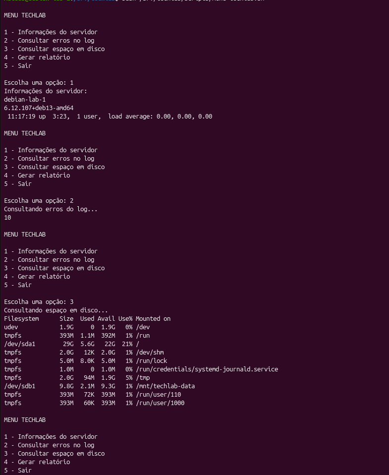
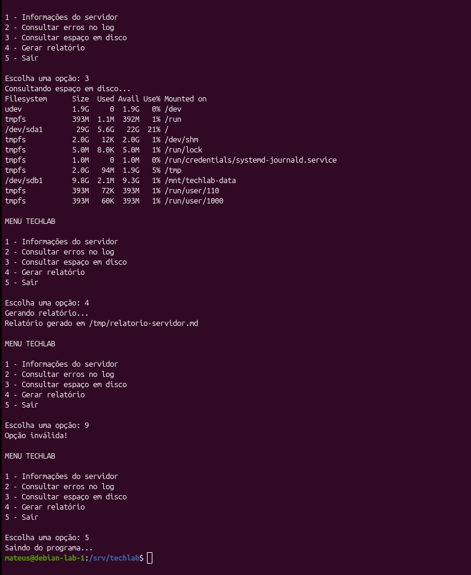
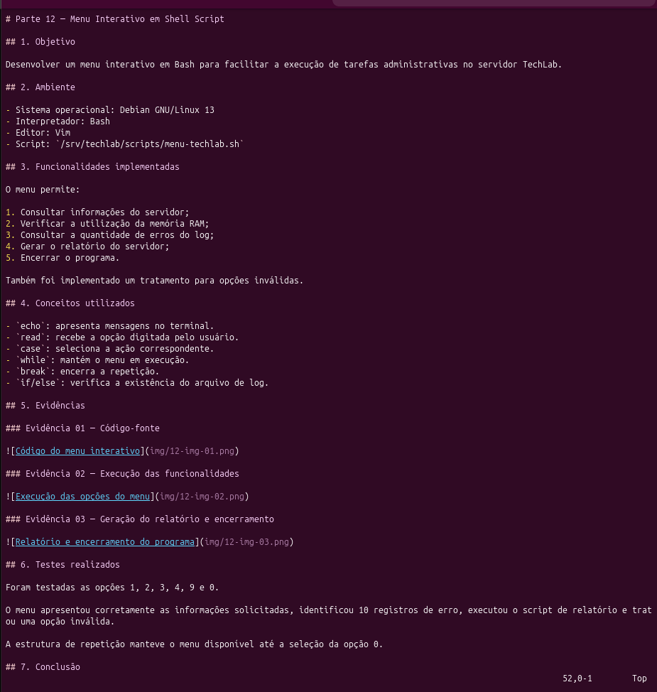

# Parte 12 — Menu Interativo em Shell Script

## 1. Objetivo

Desenvolver um menu interativo em Bash para facilitar a execução de tarefas administrativas no servidor TechLab.

## 2. Ambiente

- Sistema operacional: Debian GNU/Linux 13
- Interpretador: Bash
- Editor: Vim
- Script: `/srv/techlab/scripts/menu-techlab.sh`

## 3. Funcionalidades implementadas

O menu permite:

O menu permite:

1. Consultar informações do servidor;
2. Consultar erros no log;
3. Consultar espaço em disco;
4. Gerar o relatório do servidor;
5. Encerrar o programa.

Também foi implementado um tratamento para opções inválidas, exibindo a mensagem `Opção inválida!` quando o usuário informa uma opção não reconhecida.

Também foi implementado um tratamento para opções inválidas.

## 4. Conceitos utilizados

- `echo`: apresenta mensagens no terminal.
- `read`: recebe a opção digitada pelo usuário.
- `case`: seleciona a ação correspondente.
- `while`: mantém o menu em execução.
- `break`: encerra a repetição.
- `if/else`: verifica a existência do arquivo de log.

## 5. Evidências

### Evidência 01 — Código-fonte

### Evidência 02 — Execução das funcionalidades

### Evidência 03 — Geração do relatório e encerramento

## 6. Testes realizados

O script `menu-techlab.sh` foi executado no terminal do Debian GNU/Linux 13 para verificar o funcionamento de todas as opções.

| Opção testada | Resultado observado |
|---|---|
| 1 — Informações do servidor | Exibiu o hostname `debian-lab-1`, a versão do kernel e o tempo de atividade do sistema. |
| 2 — Consultar erros no log | Consultou o arquivo `acessos.log` e identificou 10 ocorrências de `ERRO`. |
| 3 — Consultar espaço em disco | Executou `df -h` e apresentou o espaço utilizado e disponível nos sistemas de arquivos. |
| 4 — Gerar relatório | Executou o script de relatório e informou o arquivo `/tmp/relatorio-servidor.md`. |
| 9 — Opção inválida | Exibiu a mensagem `Opção inválida!` e retornou ao menu. |
| 5 — Sair | Exibiu `Saindo do programa...` e encerrou a execução do script. |

Durante os testes, foi observado que a estrutura `while` manteve o menu em execução após cada operação, até que a opção `5` fosse selecionada.

O comando `read` recebeu as escolhas do usuário e a estrutura `case` direcionou a execução para cada funcionalidade.

**Resultado:** as opções do menu foram executadas conforme o comportamento esperado. A validação detalhada do conteúdo do relatório será apresentada na documentação da Parte 11.

## 7. Conclusão

O menu interativo foi implementado e testado com sucesso.

A atividade permitiu aplicar estruturas condicionais e de repetição em Bash, além de integrar funcionalidades desenvolvidas anteriormente no projeto TechLab.
