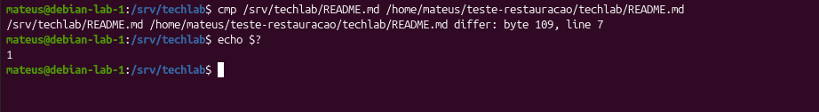

# Parte 13 — Backup e Restauração com TAR

## 1. Objetivo

Realizar um backup compactado dos arquivos do servidor TechLab utilizando o comando `tar`, verificar o conteúdo armazenado, restaurar os arquivos em um diretório separado e validar sua integridade por meio de comparações com o comando `cmp`.

A atividade tem como objetivos:

- Compreender a importância dos backups na administração de sistemas GNU/Linux;
- Utilizar o comando `tar` para criar e consultar arquivos compactados;
- Realizar a restauração dos arquivos sem modificar os dados originais;
- Verificar o conteúdo dos arquivos restaurados;
- Utilizar códigos de saída para interpretar os resultados;
- Comprovar a integridade dos arquivos selecionados.

## 2. Ambiente utilizado

| Item | Descrição |
|---|---|
| Sistema operacional | Debian GNU/Linux 13 |
| Servidor | `debian-lab-1` |
| Ambiente de virtualização | Oracle VirtualBox |
| Diretório original | `/srv/techlab` |
| Destino do backup | `/mnt/techlab-data` |
| Arquivo de backup | `techlab-backup-corrigido.tar.gz` |
| Diretório de restauração | `/home/mateus/restauracao-validacao` |
| Formato do backup | `.tar.gz` |

## 3. Criação do backup

O backup foi realizado utilizando o comando `tar`, responsável por reunir arquivos e diretórios em um único arquivo compactado.

Antes da criação do backup, foi utilizado o comando:

```bash
findmnt /mnt/techlab-data
```

Esse comando permite verificar se existe um sistema de arquivos montado no diretório utilizado para armazenar os backups.

Para criar o arquivo compactado, foi utilizado:

```bash
sudo tar -czvf /mnt/techlab-data/techlab-backup-corrigido.tar.gz -C /srv techlab/
```

As opções utilizadas foram:

- `-c`: cria um arquivo TAR;
- `-z`: utiliza a compactação gzip;
- `-v`: apresenta os arquivos processados;
- `-f`: especifica o nome do arquivo;
- `-C`: define o diretório-base da operação.

O arquivo gerado foi armazenado em `/mnt/techlab-data`, separado do diretório original do projeto.

### Evidência 01 — Criação e identificação do backup


## 4. Verificação do conteúdo do backup

Após a criação, foi realizada a verificação do conteúdo do arquivo compactado:

```bash
sudo tar -tzf /mnt/techlab-data/techlab-backup-corrigido.tar.gz
echo $?
```

O comando apresentou os arquivos e diretórios armazenados, incluindo:

- `techlab/README.md`;
- `techlab/acessos.log`;
- `techlab/scripts/menu-techlab.sh`;
- `techlab/scripts/relatorio-servidor.sh`;
- `techlab/desenvolvimento/`;
- `techlab/administracao/`;
- `techlab/compartilhado/`;
- `techlab/suporte/`.

O código de saída retornado foi `0`, indicando que o TAR conseguiu percorrer e listar o conteúdo do arquivo compactado sem apresentar erros.

### Evidência 02 — Listagem do backup


## 5. Restauração dos arquivos

Para testar a restauração sem modificar os arquivos originais do servidor, foi criado um diretório separado:

```bash
mkdir -p /home/mateus/restauracao-validacao
```

Em seguida, o arquivo compactado foi extraído:

```bash
sudo tar -xzf /mnt/techlab-data/techlab-backup-corrigido.tar.gz -C /home/mateus/restauracao-validacao
```

As opções utilizadas foram:

- `-x`: extrai os arquivos do TAR;
- `-z`: utiliza a descompactação gzip;
- `-f`: identifica o arquivo de backup;
- `-C`: define o diretório onde os arquivos serão extraídos.

Para conferir os arquivos restaurados, foi utilizado:

```bash
sudo ls -lh /home/mateus/restauracao-validacao/techlab
```

A listagem confirmou a presença do `README.md`, do `acessos.log` e dos diretórios do projeto TechLab.

### Evidência 03 — Restauração dos arquivos


## 6. Validação de integridade com CMP

Após a restauração, foram realizadas comparações entre os arquivos restaurados e seus respectivos conteúdos armazenados no backup.

O comando `cmp` permite comparar dois arquivos byte a byte, identificando possíveis diferenças.

Os principais códigos de saída são:

| Código | Significado |
|---|---|
| `0` | Os arquivos comparados são idênticos |
| `1` | Os arquivos apresentam diferenças |
| `2` | Ocorreu um erro durante a comparação |

### 6.1 Comparação do README.md

Foi utilizado o comando:

```bash
sudo bash -c 'cmp <(tar -xOzf /mnt/techlab-data/techlab-backup-corrigido.tar.gz techlab/README.md) /home/mateus/restauracao-validacao/techlab/README.md; echo "Código de saída do cmp: $?"'
```

Resultado observado:

```text
Código de saída do cmp: 0
```

O resultado confirmou que o arquivo `README.md` restaurado possuía o mesmo conteúdo da versão armazenada no backup.

### 6.2 Comparação do acessos.log

Foi utilizado:

```bash
sudo bash -c 'cmp <(tar -xOzf /mnt/techlab-data/techlab-backup-corrigido.tar.gz techlab/acessos.log) /home/mateus/restauracao-validacao/techlab/acessos.log; echo "Código de saída do cmp: $?"'
```

Resultado observado:

```text
Código de saída do cmp: 0
```

O resultado confirmou que o arquivo de log restaurado era idêntico ao armazenado no backup.

### 6.3 Comparação do menu-techlab.sh

Foi utilizado:

```bash
sudo bash -c 'cmp <(tar -xOzf /mnt/techlab-data/techlab-backup-corrigido.tar.gz techlab/scripts/menu-techlab.sh) /home/mateus/restauracao-validacao/techlab/scripts/menu-techlab.sh; echo "Código de saída do cmp: $?"'
```

Resultado observado:

```text
Código de saída do cmp: 0
```

O resultado confirmou que o script restaurado era idêntico ao armazenado no backup.

### 6.4 Resultados das comparações

| Arquivo | Código de saída | Resultado |
|---|---|---|
| `README.md` | `0` | Conteúdo idêntico |
| `acessos.log` | `0` | Conteúdo idêntico |
| `scripts/menu-techlab.sh` | `0` | Conteúdo idêntico |

Os três arquivos selecionados foram comparados com sucesso.

### Evidência 04 — Comparações com CMP


## 7. Comparação entre versões diferentes do README

Também foi realizada uma comparação entre o README atual do projeto e uma versão restaurada anteriormente.

Comandos utilizados:

```bash
cmp /srv/techlab/README.md /home/mateus/teste-restauracao/techlab/README.md
echo $?
```

O comando identificou uma diferença no byte 109, linha 7, retornando o código de saída `1`.

O resultado demonstra que os arquivos comparados não eram idênticos.

Como o README foi atualizado durante o desenvolvimento do TechLab, uma possível explicação é que o arquivo restaurado corresponda a uma versão anterior.

Essa diferença não comprova, isoladamente, uma falha no processo de backup.

### Evidência 05 — Diferença entre versões do README



## 8. Resultados dos testes

Os procedimentos realizados apresentaram os seguintes resultados:

| Teste | Resultado |
|---|---|
| Identificação do backup | Arquivo encontrado |
| Listagem com `tar -tzf` | Código de saída `0` |
| Restauração em diretório separado | Arquivos extraídos e localizados |
| Comparação do `README.md` | Código `0` |
| Comparação do `acessos.log` | Código `0` |
| Comparação do `menu-techlab.sh` | Código `0` |
| Comparação do README atual com versão antiga | Código `1` — arquivos diferentes |

A verificação com `tar -tzf` confirmou que o conteúdo do arquivo compactado pôde ser percorrido sem erros.

A restauração demonstrou que os arquivos selecionados podiam ser extraídos.

As comparações com `cmp` confirmaram que os três arquivos restaurados possuíam o mesmo conteúdo das versões armazenadas no backup.

## 9. Conhecimentos adquiridos

Durante a atividade, foram praticados conceitos de administração de sistemas GNU/Linux, incluindo:

- Criação de backups com `tar`;
- Compactação de arquivos utilizando gzip;
- Consulta do conteúdo de arquivos `.tar.gz`;
- Restauração de diretórios e arquivos;
- Comparação de arquivos utilizando `cmp`;
- Interpretação de códigos de saída;
- Identificação de diferenças entre versões de arquivos;
- Importância de validar backups antes de depender deles em uma recuperação real.

Também foi possível compreender que a simples existência de um arquivo de backup não garante que seus dados possam ser restaurados corretamente.

## 10. Conclusão

A atividade permitiu realizar a verificação e a restauração de um backup do servidor TechLab utilizando ferramentas disponíveis no Debian GNU/Linux.

O arquivo `techlab-backup-corrigido.tar.gz` foi consultado com sucesso e seus arquivos foram restaurados em um diretório separado, preservando os dados originais.

As comparações com `cmp` apresentaram código de saída `0` para os três arquivos selecionados, confirmando a igualdade entre os conteúdos restaurados e armazenados no backup.

Também foi identificada uma diferença entre versões distintas do README, demonstrando a importância de considerar alterações realizadas após a criação de um backup.

Os testes reforçaram a necessidade de verificar o conteúdo dos backups e realizar restaurações periódicas para avaliar a confiabilidade do processo.
