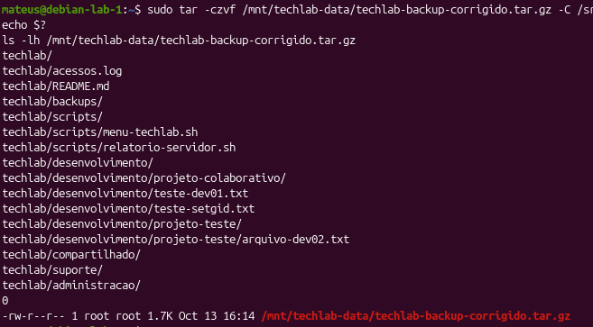
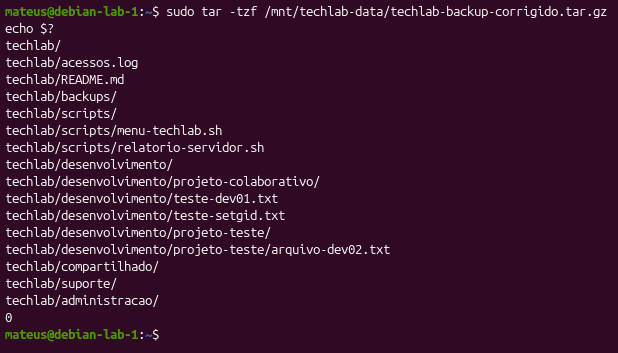
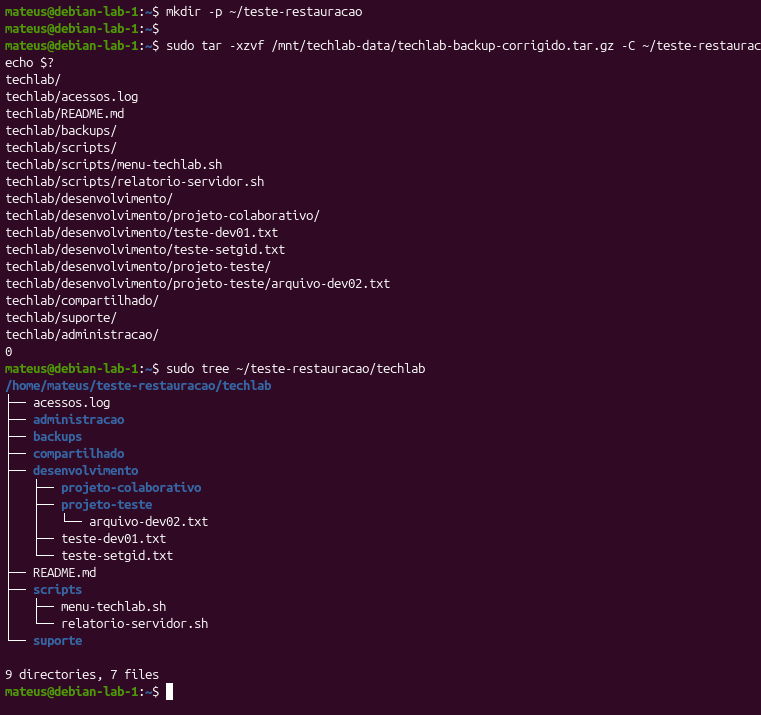
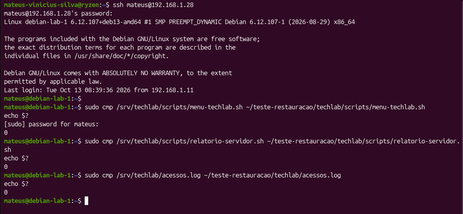

# Parte 13 — Backup e Restauração com TAR

## 1. Objetivo

Realizar um backup compactado dos arquivos do servidor TechLab utilizando o comando `tar`, verificar seu conteúdo e testar a restauração dos dados sem comprometer os arquivos originais.

## 2. Ambiente utilizado

| Item | Descrição |
|---|---|
| Sistema operacional | Debian GNU/Linux 13 |
| Servidor | debian-lab-1 |
| Diretório de origem | `/srv/techlab` |
| Destino do backup | `/mnt/techlab-data` |
| Formato | `.tar.gz` |
| Diretório de restauração | `/home/mateus/teste-restauracao` |

## 3. Criação do backup

Antes de iniciar, foi verificado se o dispositivo de armazenamento estava montado:

```bash
findmnt /mnt/techlab-data
```

O backup foi criado utilizando:

```bash
sudo tar -czvf /mnt/techlab-data/techlab-backup-corrigido.tar.gz -C /srv techlab/
```

As opções utilizadas foram:

- `-c`: criar o arquivo tar;
- `-z`: utilizar compactação gzip;
- `-v`: exibir os arquivos processados;
- `-f`: especificar o arquivo de backup;
- `-C`: definir o diretório-base da operação.

Após a execução, foi utilizado `echo $?`, que retornou `0`, indicando que o comando terminou com sucesso.

### Evidência 01 — Criação do backup



## 4. Verificação do conteúdo

Para verificar quais arquivos estavam armazenados no backup, foi utilizado:

```bash
sudo tar -tzf /mnt/techlab-data/techlab-backup-corrigido.tar.gz
echo $?
```

A listagem apresentou os diretórios dos departamentos, os scripts de administração, o arquivo de log e o README do projeto.

O comando retornou código de saída `0`.

### Evidência 02 — Conteúdo do backup



## 5. Restauração do backup

Foi criado um diretório separado para realizar a restauração sem sobrescrever os arquivos originais:

```bash
mkdir -p ~/teste-restauracao
```

Em seguida, o backup foi extraído:

```bash
sudo tar -xzvf /mnt/techlab-data/techlab-backup-corrigido.tar.gz -C ~/teste-restauracao
echo $?
```

Para verificar a estrutura restaurada:

```bash
sudo tree ~/teste-restauracao/techlab
```

A restauração foi concluída com código de saída `0`. A estrutura recuperada apresentou 9 diretórios e 7 arquivos.

### Evidência 03 — Restauração dos arquivos



## 6. Verificação da integridade dos arquivos

Para comparar o conteúdo dos arquivos originais com os restaurados, foram utilizados os seguintes comandos:

**Script do menu:**

```bash
sudo cmp /srv/techlab/scripts/menu-techlab.sh ~/teste-restauracao/techlab/scripts/menu-techlab.sh
echo $?
```

**Script de relatório:**

```bash
sudo cmp /srv/techlab/scripts/relatorio-servidor.sh ~/teste-restauracao/techlab/scripts/relatorio-servidor.sh
echo $?
```

**Arquivo de log:**

```bash
sudo cmp /srv/techlab/acessos.log ~/teste-restauracao/techlab/acessos.log
echo $?
```

O comando `cmp` compara arquivos byte a byte. O código de saída `0` indica que os arquivos comparados possuem conteúdo idêntico.

*Resultado dos testes de comparação: preencher após a execução.*

### Evidência 04 — Comparação dos arquivos



## 7. Conhecimentos adquiridos

Durante a atividade, foram praticados:

- Criação de backups compactados com `tar` e gzip;
- Utilização de caminhos relativos com `-C`;
- Verificação do conteúdo de arquivos `.tar.gz`;
- Restauração de arquivos em um diretório separado;
- Comparação de arquivos com `cmp`;
- Verificação do código de saída com `$?`;
- Utilização de `sudo` para acessar diretórios protegidos.

## 8. Conclusão

A atividade demonstrou a importância de realizar backups e testar a recuperação dos dados.

O backup do diretório `/srv/techlab` foi criado, inspecionado e restaurado com sucesso em um ambiente separado.

A comparação entre os arquivos originais e restaurados permitirá confirmar a integridade do conteúdo recuperado, concluindo a validação do procedimento de backup.
