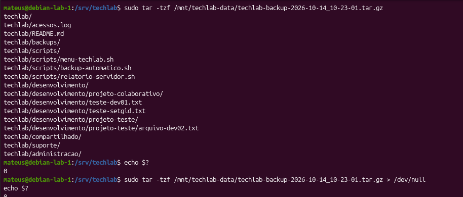
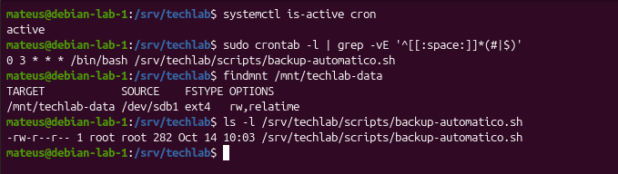
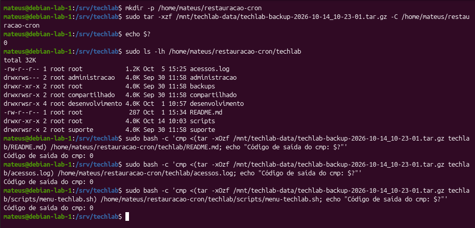

# Parte 14 — Automatização de Backups com Cron

## 1. Objetivo

Automatizar a criação de backups do servidor TechLab utilizando Shell Script e o serviço Cron do GNU/Linux.

A atividade tem como objetivo garantir que os arquivos do projeto sejam copiados periodicamente para um dispositivo de armazenamento separado, sem necessidade de executar manualmente o comando de backup.

Além da automação, foram realizados testes para verificar:

- A sintaxe e as permissões do script;
- O funcionamento do serviço Cron;
- A configuração do agendamento;
- Os registros das execuções automáticas;
- A criação dos arquivos de backup;
- A integridade de leitura dos arquivos compactados;
- A restauração dos dados;
- A comparação dos arquivos restaurados utilizando `cmp`.

## 2. Ambiente utilizado

| Item | Descrição |
|---|---|
| Sistema operacional | Debian GNU/Linux 13 |
| Servidor | `debian-lab-1` |
| Virtualização | Oracle VirtualBox |
| Interpretador | Bash |
| Serviço de agendamento | Cron |
| Diretório de origem | `/srv/techlab` |
| Diretório de destino | `/mnt/techlab-data` |
| Dispositivo de armazenamento | `/dev/sdb1` |
| Sistema de arquivos | `ext4` |
| Script | `/srv/techlab/scripts/backup-automatico.sh` |
| Usuário responsável pelo agendamento | `root` |
| Frequência definitiva | Diariamente às 03h00 |
| Formato do backup | `.tar.gz` |

## 3. Desenvolvimento do script de backup

Foi utilizado o script `backup-automatico.sh`, responsável por criar arquivos compactados do diretório `/srv/techlab`.

O script define a origem, o destino e um nome de arquivo contendo a data e o horário da execução.

Também verifica se o dispositivo de armazenamento está montado antes de iniciar o backup.

### 3.1 Código do script

```bash
#!/bin/bash

ORIGEM="/srv/techlab"
DESTINO="/mnt/techlab-data"
DATA=$(date +%Y-%m-%d_%H-%M-%S)

ARQUIVO="$DESTINO/techlab-backup-$DATA.tar.gz"

if ! mountpoint -q "$DESTINO"; then
    echo "ERRO: disco de backup não está montado."
    exit 1
fi

tar -czf "$ARQUIVO" -C /srv techlab
```

### 3.2 Explicação do funcionamento

- `ORIGEM`: identifica o diretório do projeto que será protegido.
- `DESTINO`: define onde os arquivos de backup serão armazenados.
- `DATA`: captura a data e o horário da execução.
- `ARQUIVO`: monta o caminho e o nome do backup.
- `mountpoint -q`: verifica se o destino é um ponto de montagem ativo.
- `if !`: identifica quando o dispositivo não está montado.
- `exit 1`: interrompe o script em caso de ausência do dispositivo.
- `tar -czf`: cria um arquivo TAR compactado com gzip.
- `-C /srv techlab`: permite armazenar o diretório `techlab` utilizando um caminho relativo dentro do arquivo compactado.

O uso da data e do horário no nome do backup permite criar arquivos diferentes em execuções sucessivas.

A verificação do ponto de montagem evita que o script grave o backup no diretório local caso o dispositivo destinado ao armazenamento não esteja montado.

## 4. Validação do script

Antes de verificar a automação, foram analisados o conteúdo, as permissões e a sintaxe do script.

### 4.1 Visualização do código

```bash
sudo nl -ba /srv/techlab/scripts/backup-automatico.sh
```

O comando apresentou o conteúdo do script com numeração de linhas.

### 4.2 Verificação das permissões

```bash
ls -l /srv/techlab/scripts/backup-automatico.sh
```

Resultado observado:

```text
-rwxr-x--- 1 root root 282 Oct 14 10:03 /srv/techlab/scripts/backup-automatico.sh
```

O arquivo pertence ao usuário `root` e ao grupo `root`, com permissões `750`.

Isso significa que:

- O proprietário possui permissão de leitura, escrita e execução;
- O grupo possui permissão de leitura e execução;
- Outros usuários não possuem permissões sobre o arquivo.

### 4.3 Verificação sintática

```bash
bash -n /srv/techlab/scripts/backup-automatico.sh
echo $?
```

**Resultado observado:** `0`.

O Bash não identificou erros de sintaxe no script.

Essa verificação analisa a estrutura do código sem executar a criação de um backup.

### Evidência 01 — Script, permissões e verificação sintática


**Resultado:** o script foi localizado, suas permissões foram verificadas e a análise sintática retornou código `0`.

## 5. Configuração do Cron

O serviço Cron foi utilizado para automatizar a execução do script de backup.

### 5.1 Verificação do serviço

```bash
systemctl is-active cron
```

Resultado:

```text
active
```

O resultado indica que o serviço Cron estava ativo no momento da verificação.

### 5.2 Consulta ao agendamento

```bash
sudo crontab -l
```

O agendamento identificado foi:

```cron
0 3 * * * /bin/bash /srv/techlab/scripts/backup-automatico.sh
```

Também foi utilizado:

```bash
sudo crontab -l | grep 'backup-automatico.sh'
```

O comando confirmou a presença da tarefa no crontab do usuário `root`.

### 5.3 Interpretação do agendamento

| Campo | Valor | Significado |
|---|---|---|
| Minuto | `0` | Minuto zero |
| Hora | `3` | Três horas da manhã |
| Dia do mês | `*` | Todos os dias |
| Mês | `*` | Todos os meses |
| Dia da semana | `*` | Todos os dias da semana |
| Comando | `/bin/bash ...` | Executa o script de backup |

O agendamento está configurado para executar diariamente às **03h00**, de acordo com o horário do servidor.

### Evidência 02 — Serviço e configuração do Cron


**Resultado:** o serviço Cron estava ativo e a tarefa diária foi identificada no crontab do usuário `root`.

## 6. Validação da execução automática

Para verificar a execução automática sem depender do horário definitivo das 03h00, foi realizado anteriormente um teste temporário com agendamento a cada minuto.

Após o teste, a configuração diária foi restaurada.

### 6.1 Consulta aos registros do Cron

Os registros foram consultados utilizando:

```bash
sudo journalctl -u cron --since "2026-10-14 00:00:00" --until "2026-10-14 23:59:59" --no-pager | grep 'backup-automatico.sh'
```

Foram identificados os seguintes horários de execução em 14/10/2026:

| Data | Horário |
|---|---|
| 14/10/2026 | 10:12:03 |
| 14/10/2026 | 10:13:02 |
| 14/10/2026 | 10:19:02 |
| 14/10/2026 | 10:20:03 |
| 14/10/2026 | 10:21:02 |
| 14/10/2026 | 10:22:03 |
| 14/10/2026 | 10:23:01 |

Para localizar especificamente a execução das 10h23, foi utilizado:

```bash
sudo journalctl -u cron --since "2026-10-14 10:23:00" --until "2026-10-14 10:24:00" --no-pager | grep 'backup-automatico.sh'
```

Resultado observado:

```text
Oct 14 10:23:01 debian-lab-1 CRON[1991]: (root) CMD (/bin/bash /srv/techlab/scripts/backup-automatico.sh)
```

O registro demonstra que o serviço Cron iniciou o script de backup às **10h23min01s**, utilizando o usuário `root`.

O registro de execução, isoladamente, não comprova que o backup foi concluído corretamente. Por isso, foram realizadas verificações adicionais do arquivo produzido.

### Evidência 03 — Registros de execução automática


**Resultado:** foram identificados registros de execução do script em minutos sucessivos, incluindo a execução das 10h23min01s.

## 7. Identificação do backup gerado automaticamente

Foi selecionado o arquivo correspondente à execução registrada às 10h23min01s.

**Arquivo analisado:**

`/mnt/techlab-data/techlab-backup-2026-10-14_10-23-01.tar.gz`

### 7.1 Verificação da existência do arquivo

```bash
ls -lh /mnt/techlab-data/techlab-backup-2026-10-14_10-23-01.tar.gz
```

Resultado observado:

```text
-rw-r--r-- 1 root root 1.9K Oct 14 10:23 /mnt/techlab-data/techlab-backup-2026-10-14_10-23-01.tar.gz
```

### 7.2 Consulta aos metadados

```bash
stat /mnt/techlab-data/techlab-backup-2026-10-14_10-23-01.tar.gz
```

Informações identificadas:

| Propriedade | Resultado |
|---|---|
| Tamanho | 1.858 bytes |
| Proprietário | `root` |
| Grupo | `root` |
| Permissões | `0644` |
| Modificação | 14/10/2026 às 10:23:01 |
| Criação | 14/10/2026 às 10:23:01 |

O horário de criação do arquivo corresponde ao horário registrado pelo Cron.

Essa correspondência, juntamente com o padrão de nome utilizado pelo script, constitui evidência de que o arquivo foi produzido durante o teste automático.

### Evidência 04 — Identificação e metadados do backup


**Resultado:** foi identificado um backup criado às 10h23min01s, no mesmo horário registrado pelo serviço Cron.

## 8. Verificação do conteúdo do backup automático

Após identificar o arquivo produzido pelo Cron, foi realizada a verificação de seu conteúdo utilizando `tar`.

### 8.1 Listagem dos arquivos armazenados

```bash
sudo tar -tzf /mnt/techlab-data/techlab-backup-2026-10-14_10-23-01.tar.gz
echo $?
```

Entre os arquivos e diretórios apresentados estavam:

```text
techlab/
techlab/acessos.log
techlab/README.md
techlab/backups/
techlab/scripts/
techlab/scripts/menu-techlab.sh
techlab/scripts/backup-automatico.sh
techlab/scripts/relatorio-servidor.sh
techlab/desenvolvimento/
techlab/compartilhado/
techlab/suporte/
techlab/administracao/
```

O comando também apresentou os arquivos e subdiretórios de desenvolvimento presentes no backup.

**Código de saída:** `0`.

### 8.2 Verificação completa da leitura

Para verificar o processamento da listagem sem exibir todos os arquivos novamente, foi executado:

```bash
sudo tar -tzf /mnt/techlab-data/techlab-backup-2026-10-14_10-23-01.tar.gz > /dev/null
echo $?
```

**Código de saída:** `0`.

Os dois testes terminaram sem erros detectados pelo comando `tar`.

Isso demonstra que o arquivo compactado pôde ser lido e listado corretamente.

### Evidência 05 — Validação do conteúdo com TAR



**Resultado:** as duas verificações com `tar -tzf` retornaram código `0`.

## 9. Confirmação da configuração definitiva

Após os testes de execução automática, foi verificado se o servidor permanecia com o agendamento diário e com o dispositivo de backup montado.

### 9.1 Estado do serviço

```bash
systemctl is-active cron
```

Resultado:

```text
active
```

### 9.2 Consulta às tarefas agendadas

```bash
sudo crontab -l | grep -vE '^[[:space:]]*(#|$)'
```

Resultado:

```cron
0 3 * * * /bin/bash /srv/techlab/scripts/backup-automatico.sh
```

A consulta mostrou apenas o agendamento diário, sem a tarefa temporária de execução a cada minuto.

### 9.3 Verificação do dispositivo de armazenamento

```bash
findmnt /mnt/techlab-data
```

Informações observadas:

| Propriedade | Resultado |
|---|---|
| Ponto de montagem | `/mnt/techlab-data` |
| Dispositivo | `/dev/sdb1` |
| Sistema de arquivos | `ext4` |
| Opções | `rw,relatime` |

A opção `rw` indica que o sistema de arquivos estava montado com possibilidade de leitura e escrita.

### 9.4 Verificação das permissões do script

```bash
ls -l /srv/techlab/scripts/backup-automatico.sh
```

Resultado:

```text
-rwxr-x--- 1 root root 282 Oct 14 10:03 /srv/techlab/scripts/backup-automatico.sh
```

O script permanece sob propriedade do usuário `root`, com permissões `750`.

### Evidência 06 — Configuração definitiva do Cron



**Resultado:** o Cron estava ativo, o dispositivo de backup estava montado e a configuração definitiva permanecia programada para execução diária às 03h00.

## 10. Restauração e comparação dos arquivos com `cmp`

Para complementar a validação do backup automático, foi realizado um teste de restauração e comparação de arquivos.

O objetivo foi verificar se os arquivos restaurados correspondiam, byte a byte, aos arquivos armazenados no backup.

### 10.1 Criação do diretório de restauração

```bash
mkdir -p /home/mateus/restauracao-cron
```

Foi utilizado um diretório separado para evitar alterações nos arquivos originais do servidor TechLab.

### 10.2 Extração do backup

```bash
sudo tar -xzf /mnt/techlab-data/techlab-backup-2026-10-14_10-23-01.tar.gz -C /home/mateus/restauracao-cron
echo $?
```

**Código de saída da extração:** `0`.

### 10.3 Conferência dos arquivos restaurados

```bash
sudo ls -lh /home/mateus/restauracao-cron/techlab
```

A listagem confirmou a presença de arquivos e diretórios como:

- `README.md`;
- `acessos.log`;
- `scripts/`;
- `backups/`;
- `desenvolvimento/`;
- `administracao/`;
- `compartilhado/`;
- `suporte/`.

### 10.4 Comparação do arquivo README.md

```bash
sudo bash -c 'cmp <(tar -xOzf /mnt/techlab-data/techlab-backup-2026-10-14_10-23-01.tar.gz techlab/README.md) /home/mateus/restauracao-cron/techlab/README.md; echo "Código de saída do cmp: $?"'
```

Resultado:

```text
Código de saída do cmp: 0
```

### 10.5 Comparação do arquivo acessos.log

```bash
sudo bash -c 'cmp <(tar -xOzf /mnt/techlab-data/techlab-backup-2026-10-14_10-23-01.tar.gz techlab/acessos.log) /home/mateus/restauracao-cron/techlab/acessos.log; echo "Código de saída do cmp: $?"'
```

Resultado:

```text
Código de saída do cmp: 0
```

### 10.6 Comparação do script menu-techlab.sh

```bash
sudo bash -c 'cmp <(tar -xOzf /mnt/techlab-data/techlab-backup-2026-10-14_10-23-01.tar.gz techlab/scripts/menu-techlab.sh) /home/mateus/restauracao-cron/techlab/scripts/menu-techlab.sh; echo "Código de saída do cmp: $?"'
```

Resultado:

```text
Código de saída do cmp: 0
```

### 10.7 Resultados das comparações

| Arquivo comparado | Código de saída do `cmp` | Resultado |
|---|---|---|
| `README.md` | `0` | Arquivos idênticos |
| `acessos.log` | `0` | Arquivos idênticos |
| `scripts/menu-techlab.sh` | `0` | Arquivos idênticos |

Os três testes retornaram código `0`, indicando que não foram identificadas diferenças entre os arquivos comparados.

É importante destacar que as comparações foram realizadas entre o conteúdo armazenado no backup e os arquivos restaurados.

Portanto, os resultados comprovam a fidelidade da restauração desses três arquivos em relação ao backup, e não necessariamente sua igualdade com as versões atuais existentes em `/srv/techlab`.

### Evidência 07 — Restauração e comparação com cmp



**Resultado:** a extração retornou código `0` e as três comparações com `cmp` também retornaram código `0`.

## 11. Conhecimentos adquiridos

Durante a realização da atividade, foram praticados conceitos importantes de administração de sistemas GNU/Linux:

- Criação e execução de scripts Bash;
- Utilização de variáveis e substituição de comandos;
- Verificação de dispositivos montados com `mountpoint`;
- Tratamento de condições utilizando `if`;
- Criação de arquivos compactados com `tar` e gzip;
- Configuração de tarefas automáticas com `crontab`;
- Interpretação dos campos de agendamento do Cron;
- Consulta a registros do sistema com `journalctl`;
- Verificação de arquivos e metadados com `ls` e `stat`;
- Validação da leitura de backups com `tar -tzf`;
- Restauração de arquivos compactados;
- Comparação byte a byte utilizando `cmp`;
- Interpretação de códigos de saída com `$?`;
- Verificação de permissões e propriedade de arquivos.

A atividade também demonstrou a importância de reunir evidências práticas para validar processos automatizados.

## 12. Conclusão

A Parte 14 permitiu implementar e validar uma rotina de backup automático para o servidor TechLab utilizando Shell Script e Cron no Debian GNU/Linux 13.

O script foi configurado para criar arquivos compactados do diretório `/srv/techlab`, armazenando-os em `/mnt/techlab-data` com nomes contendo a data e o horário de execução.

Durante os testes, foram identificados registros do Cron em minutos sucessivos, incluindo a execução de 14/10/2026 às 10h23min01s.

Foi localizado um backup com data e horário correspondentes ao registro de execução. A leitura e a listagem de seu conteúdo com `tar -tzf` foram concluídas com código de saída `0`.

Também foi realizada a restauração desse backup em um diretório separado. Os arquivos `README.md`, `acess
