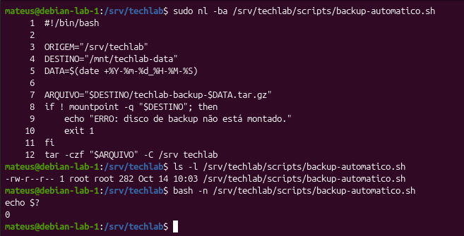
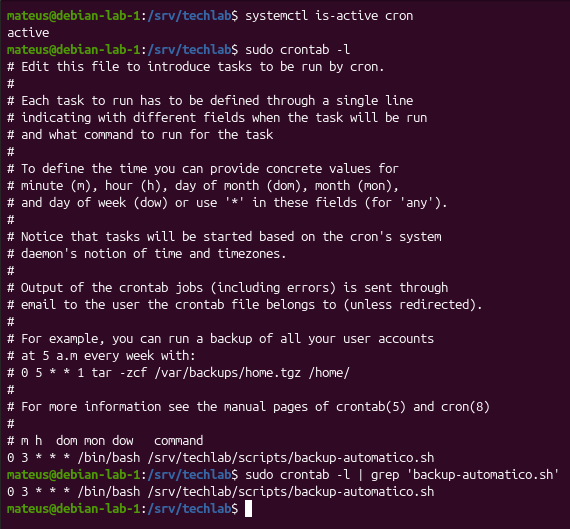
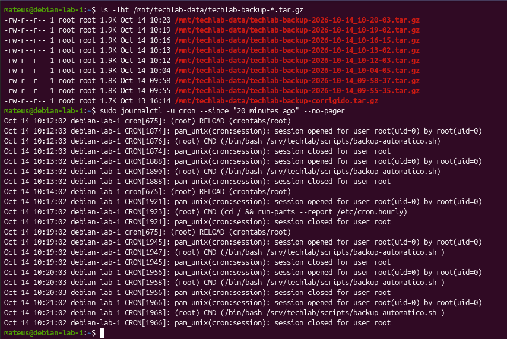
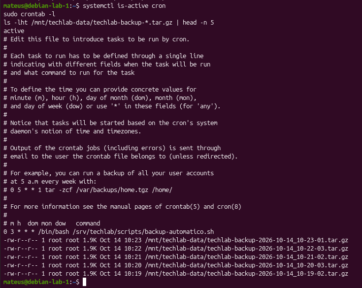

# Parte 14 — Automatização de Backups com Cron

## 1. Objetivo

Automatizar a criação de backups do servidor TechLab utilizando Shell Script e o serviço Cron do Linux.

O objetivo é garantir que os arquivos do projeto sejam copiados periodicamente, sem necessidade de executar manualmente o comando de backup.

## 2. Ambiente utilizado

| Item | Descrição |
|---|---|
| Sistema operacional | Debian GNU/Linux 13 |
| Servidor | debian-lab-1 |
| Linguagem | Bash |
| Serviço de agendamento | Cron |
| Diretório de origem | `/srv/techlab` |
| Diretório de destino | `/mnt/techlab-data` |
| Script | `/srv/techlab/scripts/backup-automatico.sh` |
| Frequência definitiva | Diariamente às 03:00 |

## 3. Desenvolvimento do script

Foi criado o arquivo `backup-automatico.sh` para automatizar a compactação dos arquivos do projeto.

```bash
#!/bin/bash

ORIGEM="/srv/techlab"
DESTINO="/mnt/techlab-data"
DATA=$(date +%Y-%m-%d_%H-%M-%S)

ARQUIVO="$DESTINO/techlab-backup-$DATA.tar.gz"

tar -czf "$ARQUIVO" -C /srv techlab
```

O script utiliza variáveis para organizar os caminhos e gera um nome de arquivo contendo a data e a hora da execução.

Dessa maneira, cada backup possui um nome diferente, evitando sobrescrever os anteriores.

A variável `ORIGEM` identifica o diretório protegido, embora o comando `tar` utilize diretamente o caminho `/srv` e o nome `techlab`.

## 4. Teste manual do script

Antes de configurar o agendamento, foi verificado se o dispositivo de armazenamento estava montado:

```bash
findmnt /mnt/techlab-data
```

Em seguida, foi realizada a verificação sintática:

```bash
bash -n /srv/techlab/scripts/backup-automatico.sh
echo $?
```

O comando retornou `0`, indicando ausência de erros de sintaxe detectáveis pelo Bash.

O script foi executado manualmente:

```bash
sudo bash /srv/techlab/scripts/backup-automatico.sh
echo $?
```

A execução retornou `0` e os arquivos gerados foram consultados com:

```bash
ls -lht /mnt/techlab-data/techlab-backup-*.tar.gz
```

### Evidência 01 — Execução manual



**Resultado:** o script gerou arquivos compactados com nomes diferentes, preservando os backups anteriores.

## 5. Configuração do Cron

Inicialmente, foi verificado o estado do serviço:

```bash
systemctl status cron --no-pager
```

O serviço apresentou o estado `active (running)`.

Para configurar a execução automática com privilégios administrativos, foi utilizado:

```bash
sudo crontab -e
```

O agendamento definitivo foi configurado da seguinte maneira:

```cron
0 3 * * * /bin/bash /srv/techlab/scripts/backup-automatico.sh
```

### Interpretação do agendamento

| Campo | Valor | Significado |
|---|---|---|
| Minuto | `0` | Minuto zero |
| Hora | `3` | Três horas da manhã |
| Dia do mês | `*` | Todos os dias |
| Mês | `*` | Todos os meses |
| Dia da semana | `*` | Todos os dias da semana |

O agendamento foi confirmado com:

```bash
sudo crontab -l
```

### Evidência 02 — Agendamento no Cron



**Resultado:** a tarefa foi registrada no crontab do usuário `root`.

## 6. Teste da execução automática

Para verificar o funcionamento do agendamento sem esperar até as 03:00, a frequência foi alterada temporariamente para uma execução por minuto:

```cron
* * * * * /bin/bash /srv/techlab/scripts/backup-automatico.sh
```

Após o período de teste, foram consultados os arquivos:

```bash
ls -lht /mnt/techlab-data/techlab-backup-*.tar.gz
```

Foram observados novos backups com horários sucessivos, incluindo 10:19, 10:20, 10:21, 10:22 e 10:23.

Esse comportamento é compatível com a execução periódica configurada para o teste.

Para complementar a validação, os registros do Cron podem ser consultados com:

```bash
sudo journalctl -u cron --since "1 hour ago" --no-pager
```

### Evidência 03 — Backups gerados durante o teste



**Resultado:** foram observados arquivos de backup criados em minutos sucessivos durante o teste de agendamento.

## 7. Restauração da configuração definitiva

Após o teste, o agendamento foi restaurado para evitar a criação excessiva de arquivos e o consumo desnecessário de armazenamento.

Configuração definitiva:

```cron
0 3 * * * /bin/bash /srv/techlab/scripts/backup-automatico.sh
```

A configuração foi verificada utilizando:

```bash
systemctl is-active cron
sudo crontab -l
ls -lht /mnt/techlab-data/techlab-backup-*.tar.gz | head -n 5
```

O serviço apresentou o estado `active`, o agendamento diário estava registrado e os arquivos de backup permaneceram disponíveis.

### Evidência 04 — Configuração definitiva



## 8. Conhecimentos adquiridos

Durante esta etapa, foram praticados os seguintes conceitos:

- Automatização de tarefas administrativas no Linux;
- Criação de scripts Bash;
- Utilização de variáveis e substituição de comandos;
- Compactação de arquivos com `tar` e gzip;
- Consulta e gerenciamento do serviço Cron;
- Configuração de tarefas utilizando `crontab`;
- Interpretação de expressões de agendamento;
- Verificação de códigos de saída com `$?`;
- Validação de backups gerados periodicamente.

## 9. Conclusão

A Parte 14 permitiu automatizar a criação de backups do servidor TechLab.

O script foi testado manualmente e executou com sucesso. O serviço Cron foi configurado para executar a tarefa diariamente às 03:00.

Durante o teste com frequência de um minuto, foram observados novos arquivos de backup em horários sucessivos.

Ao final, o agendamento diário foi restaurado e confirmado, mantendo o processo de backup configurado para execução automática.
