# Documentação Final — Projeto TechLab

## 1. Ambiente

O Projeto TechLab foi desenvolvido em uma máquina virtual com Debian GNU/Linux, simulando um ambiente corporativo para praticar administração de sistemas Linux.

### Informações do servidor

| Componente | Configuração |
|---|---|
| Sistema operacional | Debian GNU/Linux 13 (Trixie) |
| Versão Debian | 13.7 |
| Kernel | 6.12.107+deb13-amd64 |
| Memória RAM | 3,8 GiB |
| Memória Swap | 1,6 GiB |
| Disco principal | `/dev/sda` |
| Partição principal | `/dev/sda1` |
| Disco adicional | `/dev/sdb` |
| Partição adicional | `/dev/sdb1` |
| Sistema de arquivos adicional | ext4 |
| Ponto de montagem adicional | `/mnt/techlab-data` |

### Comandos utilizados

```bash
cat /etc/os-release
uname -r
free -h
lsblk -f
```

Esses comandos permitiram identificar a distribuição GNU/Linux, a versão do kernel, os recursos de memória e os dispositivos de armazenamento disponíveis.

### Evidência 01 — Diagnóstico do ambiente

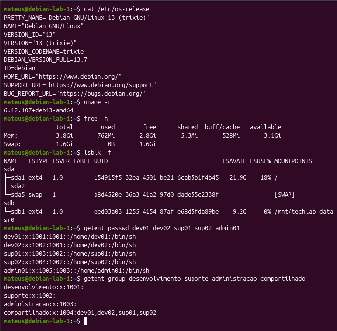

---

## 2. Usuários e grupos

Foram configurados cinco usuários e quatro grupos para representar os departamentos da empresa fictícia TechLab.

### Usuários cadastrados

| Usuário | Grupo principal | Finalidade |
|---|---|---|
| dev01 | desenvolvimento | Desenvolvimento de projetos |
| dev02 | desenvolvimento | Desenvolvimento de projetos |
| sup01 | suporte | Suporte técnico |
| sup02 | suporte | Suporte técnico |
| admin01 | administracao | Atividades administrativas |

### Grupos configurados

| Grupo | Finalidade |
|---|---|
| desenvolvimento | Organizar os usuários desenvolvedores |
| suporte | Organizar os usuários de suporte |
| administracao | Controlar o acesso ao setor administrativo |
| compartilhado | Facilitar o trabalho colaborativo entre Desenvolvimento e Suporte |

Os usuários `dev01`, `dev02`, `sup01` e `sup02` também pertencem ao grupo `compartilhado`.

### Comandos de verificação

```bash
getent passwd dev01 dev02 sup01 sup02 admin01
getent group desenvolvimento suporte administracao compartilhado

id dev01
id dev02
id sup01
id sup02
id admin01
```

Os resultados confirmaram a existência dos usuários, seus grupos principais e suas associações adicionais.

---

## 3. Estrutura de diretórios

A estrutura do projeto foi organizada em `/srv/techlab`, separando os recursos de cada departamento.

### Estrutura implementada

```text
/srv/techlab
├── administracao
├── backups
├── compartilhado
├── desenvolvimento
│   ├── projeto-colaborativo
│   └── projeto-teste
├── scripts
└── suporte
```

### Finalidade dos diretórios

| Diretório | Finalidade |
|---|---|
| `/srv/techlab` | Diretório principal do projeto |
| `administracao` | Arquivos do setor administrativo |
| `backups` | Diretório reservado para cópias de segurança |
| `compartilhado` | Compartilhamento de arquivos entre equipes |
| `desenvolvimento` | Arquivos e projetos dos desenvolvedores |
| `projeto-colaborativo` | Exercícios de colaboração entre usuários |
| `projeto-teste` | Testes de manipulação de arquivos |
| `scripts` | Scripts Bash utilizados na administração |
| `suporte` | Arquivos da equipe de suporte |

### Comando utilizado

```bash
sudo tree -d /srv/techlab
```

O comando confirmou a estrutura com nove diretórios, incluindo o diretório principal.

### Evidência 03 — Estrutura de diretórios

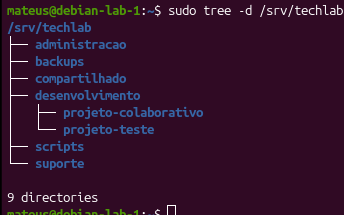

---

## 4. Permissões e propriedade

As permissões foram configuradas para controlar o acesso aos diretórios conforme os departamentos da TechLab.

### Permissões verificadas

| Diretório | Proprietário | Grupo | Permissões |
|---|---|---|---|
| administracao | root | administracao | `drwxrws---` |
| backups | root | root | `drwxr-xr-x` |
| compartilhado | root | compartilhado | `drwxrwsr-x` |
| desenvolvimento | root | desenvolvimento | `drwxrwsr-x` |
| scripts | root | root | `drwxr-xr-x` |
| suporte | root | suporte | `drwxrwsr-x` |

### Justificativa das permissões

**Administração:** somente o proprietário e os integrantes autorizados do grupo `administracao` possuem acesso ao diretório.

**Desenvolvimento e Suporte:** os membros dos grupos associados possuem permissões para trabalhar nos respectivos diretórios. Outros usuários podem listar e acessar os diretórios, mas não possuem permissão de escrita neles.

**Compartilhado:** os integrantes do grupo `compartilhado` podem criar e manipular arquivos conforme as permissões aplicáveis, facilitando o trabalho colaborativo.

**Backups e Scripts:** pertencem ao usuário `root`, restringindo a criação e alteração direta de arquivos aos usuários com privilégios adequados.

### Bit especial setgid

Os diretórios departamentais possuem o bit especial `setgid`, identificado pela letra `s` na posição de execução do grupo.

Esse recurso permite que novos arquivos e subdiretórios normalmente herdem o grupo associado ao diretório, facilitando o compartilhamento entre integrantes da mesma equipe.

### Comandos utilizados

```bash
sudo ls -ld /srv/techlab /srv/techlab/*

id dev01
id dev02
id sup01
id sup02
id admin01
```

### Evidência 02 — Usuários, grupos e permissões

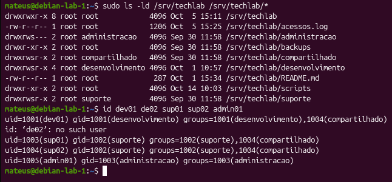

---

## 5. Disco adicional

Durante o desenvolvimento do Projeto TechLab, foi configurado um disco adicional para armazenamento de dados e backups.

### Configuração do armazenamento

| Componente | Configuração |
|---|---|
| Disco | `/dev/sdb` |
| Partição | `/dev/sdb1` |
| Sistema de arquivos | ext4 |
| Ponto de montagem | `/mnt/techlab-data` |
| Identificador UUID | `eed03a03-1255-4154-87af-e68d5fda89be` |
| Opções de montagem | `defaults` |

### Identificação do disco

Para identificar as partições e os sistemas de arquivos disponíveis, foi utilizado:

```bash
lsblk -f
```

O resultado confirmou que a partição `/dev/sdb1` utiliza o sistema de arquivos ext4.

### Verificação da montagem

A montagem foi verificada com:

```bash
findmnt /mnt/techlab-data
```

O resultado confirmou que a partição `/dev/sdb1` estava montada em `/mnt/techlab-data`, com acesso de leitura e escrita.

### Configuração persistente

Para configurar a montagem automática, foi utilizada uma entrada no arquivo `/etc/fstab`:

```fstab
UUID=eed03a03-1255-4154-87af-e68d5fda89be /mnt/techlab-data ext4 defaults 0 2
```

O UUID identifica o sistema de arquivos, evitando depender exclusivamente do nome do dispositivo, que pode mudar conforme a identificação dos discos pelo sistema.

A configuração foi consultada com:

```bash
grep -n 'techlab-data' /etc/fstab
```

### Evidência 04 — Disco adicional e montagem persistente

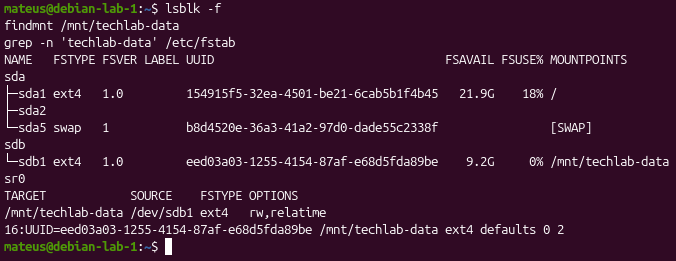

### Resultado

A partição adicional foi identificada, formatada com ext4 e montada em `/mnt/techlab-data`.

A configuração persistente foi registrada no `/etc/fstab`, permitindo que o disco seja montado automaticamente durante a inicialização do servidor.


## 6. Scripts de administração

Durante o desenvolvimento do Projeto TechLab, foram criados três scripts Bash com o objetivo de automatizar tarefas administrativas, facilitar a consulta de informações do servidor e realizar cópias de segurança.

Os scripts estão armazenados no diretório `/srv/techlab/scripts`.

### 6.1. Script de relatório do servidor

**Arquivo:** `/srv/techlab/scripts/relatorio-servidor.sh`

**Finalidade:** gerar um relatório administrativo em formato Markdown contendo informações sobre o servidor.

**Entradas:**
- Informações do sistema operacional.
- Dados de utilização de memória e armazenamento.
- Registros do arquivo `/srv/techlab/acessos.log`.

**Condições e processamento:**

O script utiliza comandos como `date`, `hostname`, `uname -r`, `uptime`, `free -h` e `df -h` para coletar informações do servidor.

Também utiliza a estrutura condicional `if/else` para verificar a existência do arquivo de log. Quando o arquivo existe, o comando `grep -c 'ERRO$'` contabiliza as linhas terminadas em `ERRO`.

**Saída:** arquivo `/tmp/relatorio-servidor.md`.

#### Evidência 05 — Visualização do código

**Comando:** `cat /srv/techlab/scripts/relatorio-servidor.sh`

A captura apresenta o código-fonte do script, incluindo os comandos de consulta, a estrutura condicional e o redirecionamento da saída.

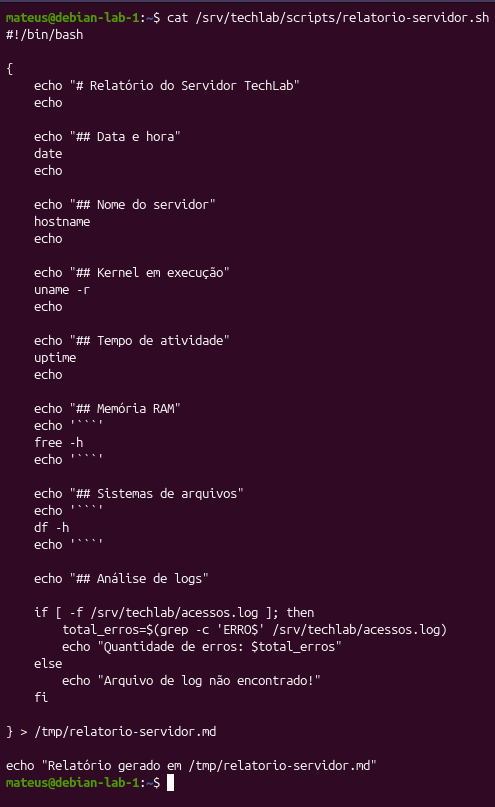

#### Evidência 06 — Validação da sintaxe

**Comando:** `bash -n /srv/techlab/scripts/relatorio-servidor.sh; echo $?`

**Resultado:** `0`.

O interpretador Bash não identificou erros de sintaxe.

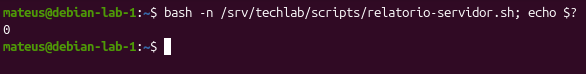

#### Evidência 07 — Execução do relatório

**Comando:** `bash /srv/techlab/scripts/relatorio-servidor.sh`

**Resultado:** `Relatório gerado em /tmp/relatorio-servidor.md`.

O script foi executado e apresentou a mensagem de conclusão prevista.


#### Evidência 08 — Verificação do relatório gerado

**Comando:** `cat /tmp/relatorio-servidor.md`

O arquivo apresentou as informações coletadas do servidor:

- Hostname: `debian-lab-1`.
- Kernel: `6.12.107+deb13-amd64`.
- Memória RAM total: aproximadamente 3,8 GiB.
- Partição principal: `/dev/sda1`.
- Disco adicional: `/dev/sdb1`.
- Quantidade de erros encontrados no log: **10**.

A evidência confirmou a geração do relatório e a presença das informações esperadas.

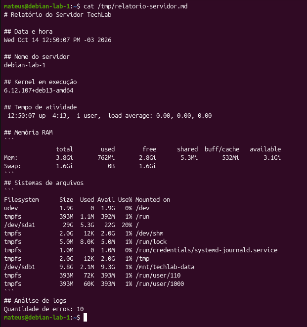

### 6.2. Script de menu interativo

**Arquivo:** `/srv/techlab/scripts/menu-techlab.sh`

**Finalidade:** disponibilizar um menu de texto para facilitar a execução de tarefas administrativas.

**Entrada:** opção numérica digitada pelo usuário, recebida pelo comando `read`.

**Condições e processamento:**

O script utiliza um laço `while` para manter o menu em execução e uma estrutura `case` para identificar a opção selecionada.

As funcionalidades implementadas são:

| Opção | Funcionalidade |
|---|---|
| 1 | Exibir informações do servidor |
| 2 | Verificar memória RAM |
| 3 | Consultar erros do log |
| 4 | Gerar relatório |
| 0 | Sair |

A opção `3` verifica se o arquivo de log existe antes de consultar seus registros. O menu também apresenta uma mensagem para opções inválidas.

**Saídas:** informações exibidas no terminal ou geração do arquivo de relatório.

#### Evidência 09 — Visualização do código

**Comando:** `cat /srv/techlab/scripts/menu-techlab.sh`

A captura demonstra o uso das estruturas `while`, `case`, `if/else` e do comando `read`.

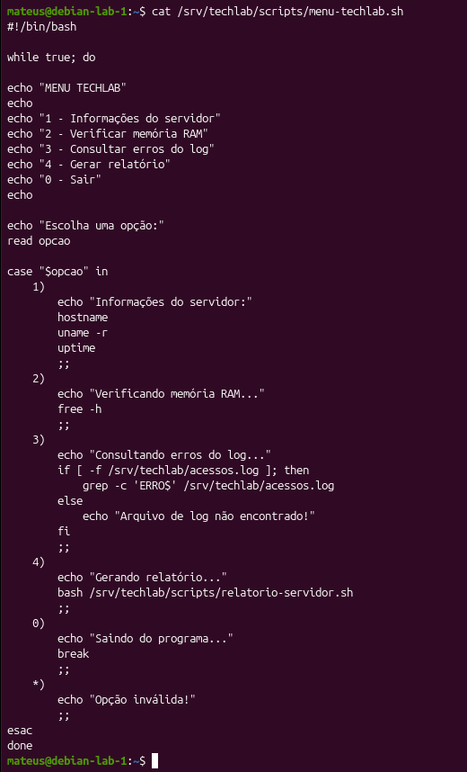

#### Evidência 10 — Validação da sintaxe

**Comando:** `bash -n /srv/techlab/scripts/menu-techlab.sh; echo $?`

**Resultado:** `0`.

O Bash não identificou erros de sintaxe no script.

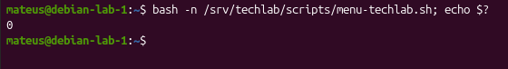

#### Evidência 11 — Execução do menu

**Comando:** `bash /srv/techlab/scripts/menu-techlab.sh`

Durante o teste, foi selecionada a opção `1`, que apresentou o hostname, o kernel e o tempo de atividade do servidor.

Após a consulta, o programa retornou ao menu principal. Em seguida, a opção `0` encerrou sua execução.

**Resultado:** funcionamento confirmado para as opções `1` e `0`.

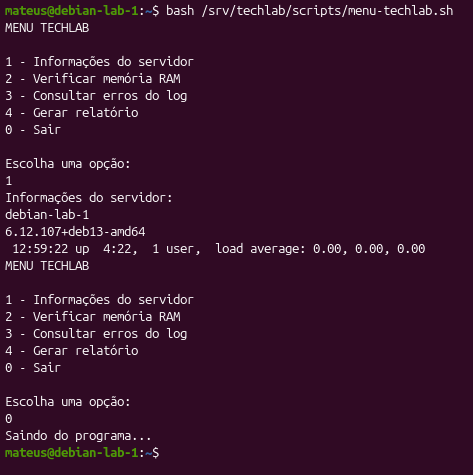

### 6.3. Script de backup automático

**Arquivo:** `/srv/techlab/scripts/backup-automatico.sh`

**Finalidade:** criar cópias de segurança compactadas do diretório do projeto TechLab.

**Entradas:**
- Diretório de origem: `/srv/techlab`.
- Diretório de destino: `/mnt/techlab-data`.
- Data e hora do sistema.

**Condições e processamento:**

O script define variáveis para identificar os diretórios e construir o nome do arquivo de backup.

Antes da compactação, utiliza `mountpoint -q` para verificar se o disco adicional está montado.

Se o ponto de montagem não estiver ativo, o script apresenta uma mensagem de erro e encerra a execução com `exit 1`.

Quando a condição de montagem é satisfeita, o comando `tar -czf` é utilizado para criar o arquivo compactado.

**Saída prevista:** arquivo no formato `techlab-backup-AAAA-MM-DD_HH-MM-SS.tar.gz`, armazenado em `/mnt/techlab-data`.

#### Evidência 12 — Visualização do código

**Comando:** `cat /srv/techlab/scripts/backup-automatico.sh`

A captura apresenta a definição das variáveis, a verificação do ponto de montagem e o comando responsável pela compactação.

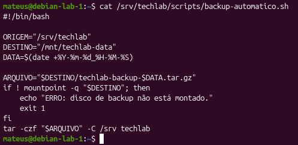

#### Evidência 13 — Validação da sintaxe

**Comando:** `bash -n /srv/techlab/scripts/backup-automatico.sh; echo $?`

**Resultado:** `0`.

O interpretador Bash não identificou erros de sintaxe no script.

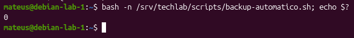

#### Evidência 14 — Verificação do disco de destino

**Comando:** `findmnt /mnt/techlab-data`

**Resultado obtido:**

- Ponto de montagem: `/mnt/techlab-data`.
- Dispositivo: `/dev/sdb1`.
- Sistema de arquivos: `ext4`.
- Opções de montagem: `rw,relatime`.

O resultado confirmou que o disco adicional estava montado e disponível para leitura e escrita.

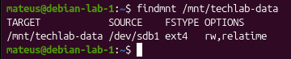

### 6.4. Considerações finais

Os três scripts demonstram a aplicação de conceitos de Shell Script, incluindo variáveis, comandos do sistema, estruturas condicionais, laços de repetição, tratamento de opções e redirecionamento de saída.

O script de relatório teve seu nome de arquivo de saída ajustado para `relatorio-servidor.md`. Os demais scripts foram preservados conforme desenvolvidos.

As evidências desta seção confirmam a sintaxe dos três scripts, a execução do relatório, o funcionamento das opções `1` e `0` do menu e a disponibilidade do disco destinado aos backups.

A execução e a verificação dos arquivos de backup foram abordadas nas etapas anteriores do projeto, relacionadas ao backup e à automação.

## 7. Backups e agendamento

### 7.1. Objetivo

A implementação de backups no Projeto TechLab tem como finalidade preservar os arquivos e diretórios do ambiente, permitindo sua recuperação em caso de exclusão acidental, falhas operacionais ou perda de dados.

Foi desenvolvido um script Bash para automatizar a criação de arquivos compactados e armazená-los no disco adicional configurado durante o projeto.

### 7.2. Configuração do backup

O processo de backup utiliza os seguintes recursos:

| Recurso | Configuração |
|---|---|
| Diretório de origem | `/srv/techlab` |
| Diretório de destino | `/mnt/techlab-data` |
| Dispositivo de armazenamento | `/dev/sdb1` |
| Sistema de arquivos | `ext4` |
| Script responsável | `/srv/techlab/scripts/backup-automatico.sh` |
| Formato dos arquivos | `.tar.gz` |
| Ferramenta de compactação | `tar` |

O script verifica inicialmente se o disco de destino está montado utilizando o comando `mountpoint -q`.

Caso o ponto de montagem não esteja ativo, a execução é interrompida para evitar que o backup seja gravado indevidamente no sistema de arquivos principal.

Quando o disco está montado, o comando `tar -czf` gera um arquivo compactado contendo o diretório do projeto.

Os arquivos recebem nomes com data e hora, seguindo o padrão:

`techlab-backup-AAAA-MM-DD_HH-MM-SS.tar.gz`

Esse padrão permite identificar quando cada backup foi produzido.

### 7.3. Verificação dos arquivos de backup

#### Evidência 15 — Backups armazenados no disco adicional

**Comando executado:**

`ls -lht /mnt/techlab-data/techlab-backup-*.tar.gz | head -n 5`

**Resultado obtido:**

O terminal apresentou quatro arquivos de backup armazenados em `/mnt/techlab-data`, todos no formato `.tar.gz`.

Os arquivos exibidos pertencem ao usuário `root`, possuem aproximadamente 1,9 KB cada e foram registrados em 14/10/2026.

A evidência confirmou a existência de cópias de segurança com identificação por data e hora.

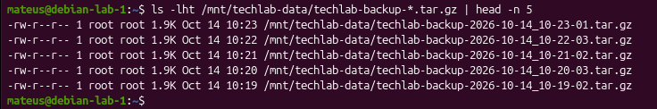

### 7.4. Verificação do conteúdo do backup

#### Evidência 16 — Listagem do arquivo compactado

**Comando executado:**

`sudo tar -tzf /mnt/techlab-data/techlab-backup-2026-10-14_10-23-01.tar.gz`

**Resultado obtido:**

O comando apresentou o conteúdo do arquivo compactado sem realizar sua extração.

Foram identificados os principais arquivos e diretórios do Projeto TechLab:

- `techlab/acessos.log`
- `techlab/README.md`
- `techlab/scripts/`
- `techlab/scripts/menu-techlab.sh`
- `techlab/scripts/backup-automatico.sh`
- `techlab/scripts/relatorio-servidor.sh`
- `techlab/desenvolvimento/`
- `techlab/suporte/`
- `techlab/administracao/`
- `techlab/compartilhado/`

A listagem confirmou que o arquivo de backup contém a estrutura do projeto e seus principais arquivos administrativos.

A inspeção do conteúdo não substitui um teste de restauração, mas permite verificar se os caminhos esperados foram incluídos no arquivo.

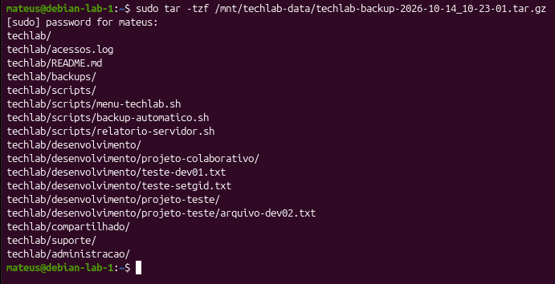

### 7.5. Automação com cron

Para automatizar a execução dos backups, foi utilizado o serviço de agendamento de tarefas do GNU/Linux, por meio do crontab do usuário `root`.

O agendamento foi configurado para executar o script diariamente às 03:00, de acordo com o horário do servidor.

#### Evidência 17 — Verificação do agendamento

**Comando executado:**

`sudo crontab -l`

**Configuração identificada:**

```cron
0 3 * * * /bin/bash /srv/techlab/scripts/backup-automatico.sh
```

**Interpretação dos campos:**

| Campo | Valor | Significado |
|---|---|---|
| Minuto | `0` | No minuto zero |
| Hora | `3` | Às 03:00 |
| Dia do mês | `*` | Todos os dias |
| Mês | `*` | Todos os meses |
| Dia da semana | `*` | Todos os dias da semana |

O comando `/bin/bash` executa o script `backup-automatico.sh` no horário estabelecido.

A captura confirma que a tarefa está registrada no crontab do usuário `root`.

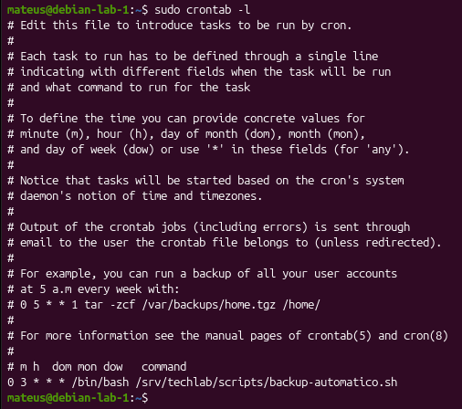

### 7.6. Restauração dos arquivos

Durante a etapa de backup e recuperação do projeto, também foi realizado um exercício de restauração utilizando a ferramenta `tar`.

O procedimento consistiu em extrair uma cópia de segurança em um diretório de testes separado, permitindo conferir a estrutura recuperada sem substituir os arquivos originais.

Essa prática é importante porque a existência de um arquivo compactado, isoladamente, não garante que os dados possam ser recuperados corretamente.

### 7.7. Considerações finais

A implementação dos backups no Projeto TechLab permitiu aplicar conceitos de administração de sistemas GNU/Linux relacionados à compactação, armazenamento, pontos de montagem e agendamento de tarefas.

As evidências registradas demonstraram:

- A existência de arquivos de backup no disco adicional.
- A presença dos principais arquivos e diretórios do projeto dentro de um backup.
- A configuração de uma tarefa cron para executar o script diariamente às 03:00.

A configuração do cron comprova o agendamento, enquanto as verificações dos arquivos demonstram a existência de backups. Essas evidências, isoladamente, não confirmam que uma execução automática ocorreu no horário programado.

O processo contribui para a continuidade operacional do ambiente TechLab e estabelece uma rotina de proteção dos arquivos do projeto.


## 8. Problemas encontrados, diagnóstico e soluções

Durante o desenvolvimento do Projeto TechLab, foram encontrados problemas relacionados à identificação do ambiente de execução e à sintaxe de scripts Bash.

Essas situações permitiram aplicar procedimentos de diagnóstico, identificar possíveis causas e realizar correções.

### 8.1. Problema 1 — Execução de comandos no ambiente incorreto

**Problema identificado:**

Durante algumas etapas do projeto, comandos destinados ao servidor Debian foram executados no terminal do computador local.

Isso causou dificuldades na localização de arquivos e diretórios, pois os dois ambientes possuem sistemas de arquivos e configurações diferentes.

**Evidência do problema:**

A dificuldade foi identificada durante as atividades práticas, quando o ambiente utilizado não correspondia ao servidor esperado.

As evidências abaixo demonstram as verificações realizadas para identificar o ambiente correto após o problema.

**Hipótese:**

A causa provável era a confusão entre o terminal do computador local e a sessão SSH utilizada para acessar o servidor Debian.

**Teste realizado:**

Foi utilizado o comando `hostname` para identificar a máquina em que os comandos estavam sendo executados.

#### Evidência 18 — Identificação do servidor

**Comando executado:**

`hostname`

**Resultado obtido:**

`debian-lab-1`

O resultado confirmou que o terminal estava conectado ao ambiente do servidor TechLab.

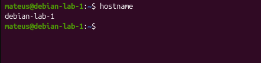

#### Evidência 19 — Verificação do usuário e do servidor

**Comando executado:**

`whoami && hostname`

**Resultado obtido:**

```text
mateus
debian-lab-1
```

O comando `whoami` identificou o usuário responsável pela sessão, enquanto `hostname` confirmou o nome do servidor.

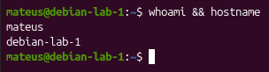

**Solução aplicada:**

Passou-se a verificar o nome da máquina e o usuário conectado antes de executar comandos administrativos.

Quando necessário, o acesso ao servidor foi realizado por meio de SSH.

**Conclusão:**

O problema demonstrou a importância de identificar corretamente o ambiente de execução, especialmente quando se trabalha com máquinas virtuais e conexões remotas.

---

### 8.2. Problema 2 — Erro de sintaxe na estrutura condicional do Bash

**Problema identificado:**

Durante o desenvolvimento dos scripts administrativos, ocorreu um erro relacionado à escrita da estrutura condicional `if`.

A condição de teste não estava utilizando corretamente os espaços exigidos pela sintaxe do Bash.

**Evidência do problema:**

O erro foi identificado durante a implementação e os testes dos scripts. A captura atual apresenta a estrutura após a correção, e não a mensagem original do erro.

**Hipótese:**

A causa estava relacionada à utilização incorreta dos colchetes na expressão condicional.

Em Bash, o comando `[` exige espaços entre os seus argumentos e o colchete de fechamento.

**Teste realizado:**

Foi utilizado o comando `grep` para localizar a estrutura condicional no script de relatório e verificar sua escrita.

#### Evidência 20 — Verificação da condição corrigida

**Comando executado:**

`grep -n -A 5 'if \[' /srv/techlab/scripts/relatorio-servidor.sh`

**Resultado obtido:**

O terminal apresentou a estrutura condicional utilizada para verificar a existência do arquivo de log:

```bash
if [ -f /srv/techlab/acessos.log ]; then
    total_erros=$(grep -c 'ERRO$' /srv/techlab/acessos.log)
    echo "Quantidade de erros: $total_erros"
else
    echo "Arquivo de log não encontrado!"
fi
```

A estrutura apresenta corretamente os espaços entre os colchetes, o operador `-f`, o caminho do arquivo e os comandos `then`, `else` e `fi`.

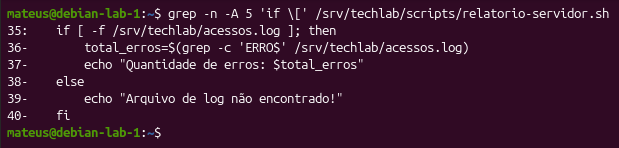

**Solução aplicada:**

A estrutura condicional foi corrigida para utilizar a sintaxe adequada do Bash.

A validação de sintaxe do script completo foi documentada anteriormente na Evidência 06, por meio do comando:

`bash -n /srv/techlab/scripts/relatorio-servidor.sh; echo $?`

O resultado registrado foi `0`, indicando que o Bash não identificou erros de sintaxe após a correção.

**Conclusão:**

O problema demonstrou a importância de respeitar a sintaxe das estruturas condicionais em Shell Script e de realizar verificações antes de executar scripts administrativos.

---

### 8.3. Considerações finais

Os problemas encontrados durante o Projeto TechLab contribuíram para o desenvolvimento de habilidades práticas de diagnóstico e resolução de erros em ambientes GNU/Linux.

O primeiro problema reforçou a importância de identificar corretamente o usuário e o servidor antes de executar comandos.

O segundo demonstrou a necessidade de compreender a sintaxe do Bash e utilizar ferramentas de validação para identificar erros.

As soluções aplicadas permitiram dar continuidade às atividades e melhorar os procedimentos de administração do ambiente TechLab.
